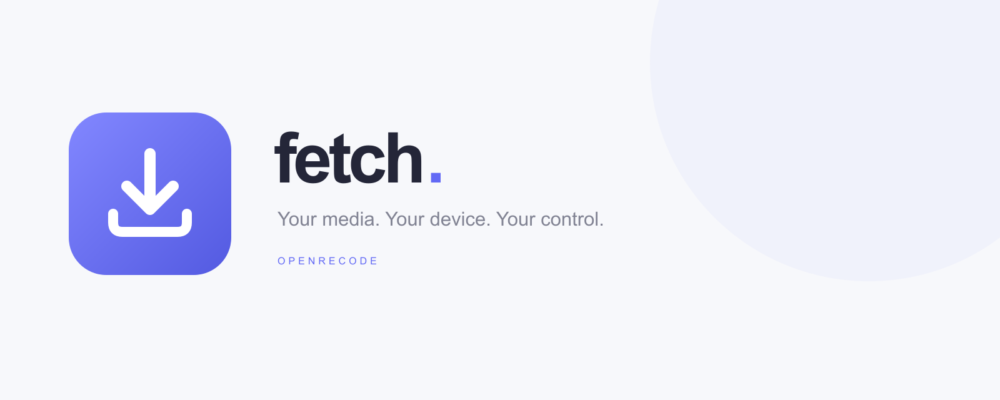

<p align="center"></p>
<h1 align="center">Fetch</h1>
<p align="center">Your media. Your device. Your control.</p>

Native SwiftUI media downloader and self-hosted yt-dlp/FFmpeg service, part of OpenRecode. Save media you own or are authorized to keep. No ads, tracking, mandatory subscriptions, proprietary backend, DRM circumvention, or cookie harvesting.

**Development status:** the real backend workflow is tested with generated authorized fixtures. The native client is implemented in source but has **not been compiled or tested on iOS** because the configured Xcode volume is unavailable. Docker configuration is prepared but Docker is unavailable locally. This is not a production-ready or published release. See [verification and remaining work](docs/reports/VALIDATION.md).

## Run locally

Requires Python 3.11+, FFmpeg/FFprobe on PATH, and optionally Deno for sources that require JavaScript challenges. Tested with Python 3.13.15, yt-dlp 2026.10.26, FastAPI 0.162.0, Starlette 1.10.0. Full versions are in `requirements.lock`. Use HTTPS for access from another device.

```sh
python3.13 -m venv .venv
.venv/bin/pip install -r requirements.lock
.venv/bin/pip install -e '.[test]'
.venv/bin/python scripts/configure.py
.venv/bin/python scripts/run.py init
.venv/bin/python scripts/package_source.py
.venv/bin/python scripts/run.py api
```

In a second terminal:

```sh
.venv/bin/python scripts/run.py worker
```

Open [the local dashboard](http://127.0.0.1:8000). Sign in as `admin` with the password chosen during configuration. The dashboard is optional; the iOS client talks directly to the same API. Credentials remain in browser memory and must be re-entered after reload.

The dashboard is already compiled. To modify its strict TypeScript source:

```sh
npm ci
npm run check
npm run build
```

## Self-host with Docker

After configuring `.env`:

```sh
docker compose build
docker compose up -d
docker compose ps
```

The published port binds only to loopback. Add your own trusted HTTPS reverse proxy for other devices. Two non-root containers share a persistent volume. Do not expose an unsecured server. [Deployment, egress controls and backups](docs/DEPLOYMENT.md).

## Native iOS app

Open `ios/Fetch.xcodeproj` in Xcode. Select your development team for both Fetch and FetchShare; provision the App Group `group.org.openrecode.fetch` and update its identifier consistently if your account requires another identifier. Target: iOS/iPadOS 17+. No frontend package installation is needed for SwiftUI.

```sh
xcodebuild -project ios/Fetch.xcodeproj -scheme Fetch -configuration Debug \
  -sdk iphonesimulator -destination 'generic/platform=iOS Simulator' \
  -derivedDataPath build CODE_SIGNING_ALLOWED=NO build
```

Signing, physical installation, unsigned IPA packaging and simulator bundle commands: [iOS guide](docs/IOS.md). Unsigned IPAs require signing and App Group entitlements before ordinary device installation.

## Test

```sh
.venv/bin/pytest -q
npm run check
npm run build
npx playwright test
swiftc ios/FetchCore/*.swift scripts/core_check.swift -o /tmp/fetch-core-check
/tmp/fetch-core-check
```

The browser test uses an isolated temporary server and generated two-second media, never personal files. macOS tests use installed Chrome; CI configuration can use a Playwright browser via the documented environment override. [Testing](docs/TESTING.md).

## Capabilities

- Real metadata extraction and formats; typed presets and custom stream IDs.
- Durable, prioritized queue; supervised workers, retries, stop/resume with source-dependent partial reuse, cancellation, retention and resource limits.
- FFmpeg merging, audio conversion, metadata, English subtitle embedding where supported, and conditional H.264/AAC conversion for compatible video.
- Device pairing, session revocation, scoped expiring transfer credentials, Range requests, immutable checksums and owner checks.
- Native queue, background URLSession, local library, Quick Look, share/export, Photos export, Share Extension, multiple servers, Keychain and offline Ideas (native behavior remains unverified).
- Responsive dashboard with a PWA shell, offline Ideas, server management and explicit interface update prompts.

Basic URL batches are supported. Playlist item selection, QR pairing/scanning, live release update validation, advanced library organization, transfer resume data, rich metadata editing and several production requirements remain open; [feature matrix](docs/FEATURES.md) distinguishes them.

## Documentation & license

Start with [docs/INDEX.md](docs/INDEX.md) and [AGENTS.md](AGENTS.md). Original code: **AGPL-3.0-only**, copyright © 2026 OpenRecode contributors. Third-party components retain their licenses; [notices](THIRD_PARTY_NOTICES.md). Development source is stored in the private [OpenRecode-Fetch repository](https://github.com/Xarber/OpenRecode-Fetch); no public release or distribution channel is configured.
